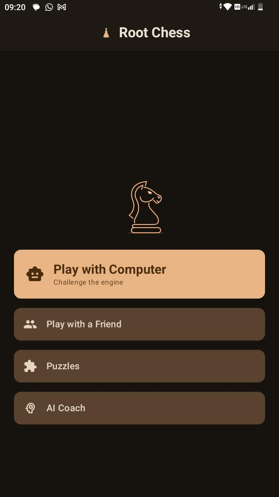
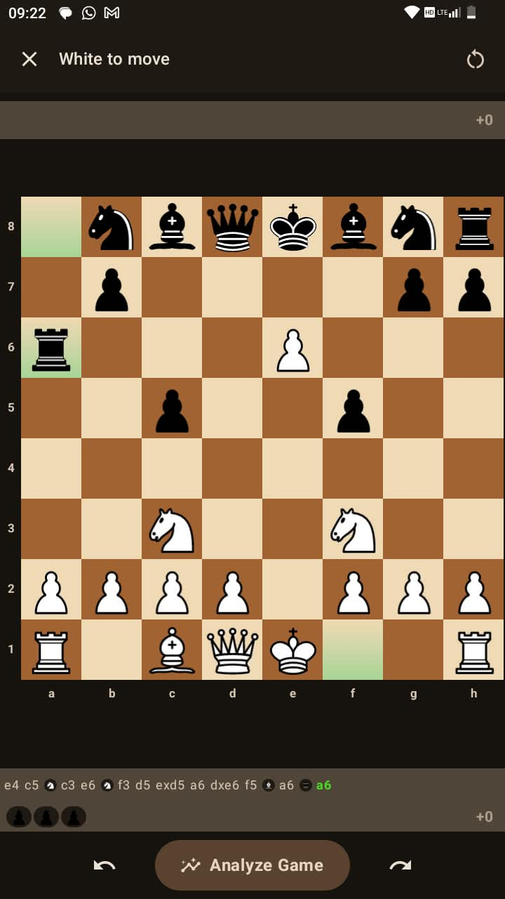
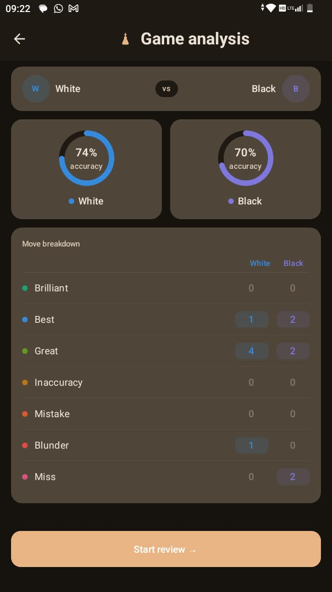
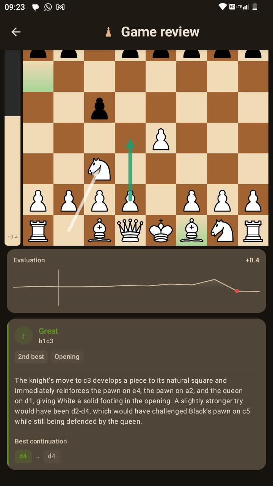
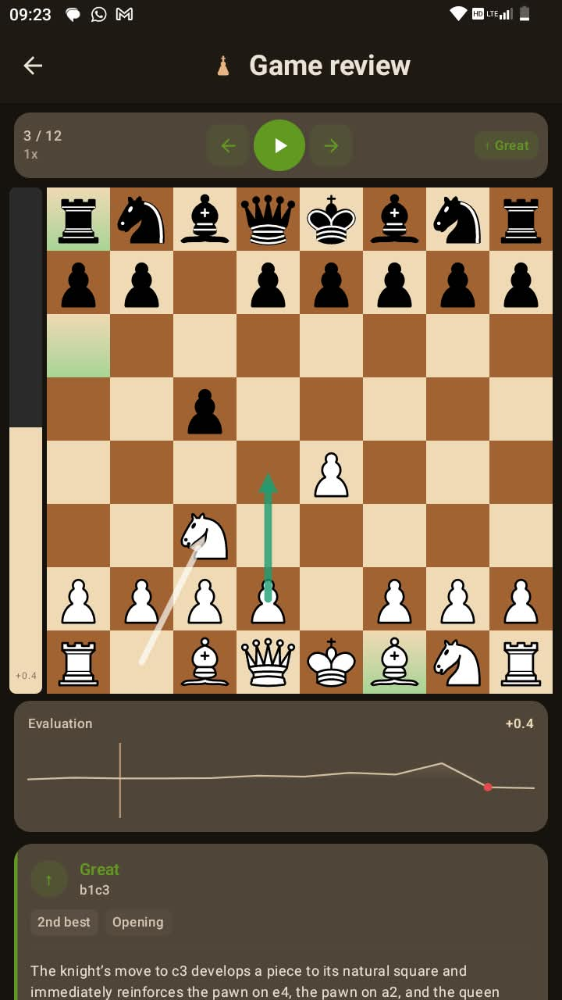
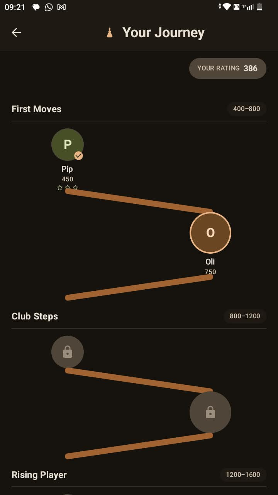

# Root Chess

Welcome to the Chess Game project! This is a simple, yet engaging, chess game built using Jetpack Compose and the MVVM (Model-View-ViewModel) architecture. The current version supports two-player gameplay on a single device, with future plans to integrate AI opponents, game analysis, and hint features.

## Features

- **Two-Player Gameplay**: Play chess against another person on the same device.
- **Modern UI**: Built using Jetpack Compose for a sleek and responsive user interface.
- **MVVM Architecture**: Clean and maintainable codebase using the Model-View-ViewModel design pattern.
- **ViewModel**: Managing UI-related data in a lifecycle-conscious way.
- 
## Screenshots

| Home | Game Play | Game Analysis |
| --- | --- | --- |
|  |  |  |

| Game Review | Your Journey |
| --- | --- |
|   |  |

## Future Milestones

- **AI Player Integration**: Implementing an AI opponent to play against.
- **Game Analysis**: Providing detailed analysis of the game with insights into moves and strategies.
- **Hints**: Offering hints to help players improve their game.

## Installation

1. Clone the repository:
   ```bash
   git clone https://github.com/yourusername/chess-game.git
   
2. Open the project in Android Studio.
3. Build and run the project on an emulator or a physical device.


## Usage

1. Launch the app.
2. Start a new game by selecting the "New Game" option.
3. Take turns with your opponent by tapping on pieces and moving them according to chess rules.


## License

This project is licensed under the Apache License 2.0. See the LICENSE file for details.

## Contributing
Contributions are welcome! Please feel free to submit a pull request or open an issue if you have any suggestions or improvements.

For any questions or feedback, please reach out to [mwatufelix1@gmail.com] or open an issue on GitHub.

Thank you for checking out the Chess Game project! We hope you enjoy playing and contributing to its development.